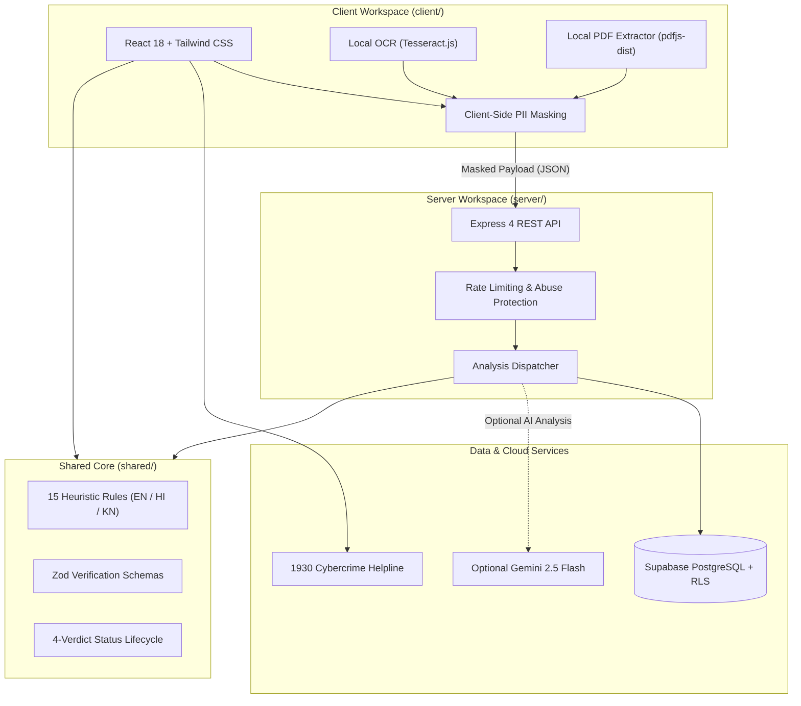

# JAANCH (जांच / ಜಾಂಚ್)

> **Digital Trust & Safety Platform for Indian Students**  
> *Know it's real before you reply.*

[](https://www.typescriptlang.org/)
[](https://nodejs.org/)
[](LICENSE)
[-brightgreen.svg)]()
[-brightgreen.svg)]()
[]()
[](https://www.w3.org/WAI/standards-guidelines/wcag/)

---

## 1. The Problem

Every year, thousands of college students and fresh job seekers across India lose their savings to predatory employment and scholarship fraud. Malicious actors impersonate reputed enterprises and government initiatives to execute advance-fee deposit traps ("refundable" laptop deposits, gate pass fees, training fees), KYC harvesting, and lookalike domain phishing over WhatsApp, Telegram, and unsolicited email.

**Jaanch** is a free, privacy-first digital trust and safety platform. It provides students and university job cells with explainable heuristic analysis, client-side PII protection, and community threat intelligence to verify offers before transferring funds, divulging OTPs, or surrendering identity documents.

---

## 2. 🌐 Live Deployments

* 🌐 **Live Website:** [https://jaanch-mu.vercel.app](https://jaanch-mu.vercel.app)
* 🚀 **API Server Health:** [https://jaanch-server.onrender.com/api/health](https://jaanch-server.onrender.com/api/health)

> [!NOTE]
> **Render Cold Starts:** The backend API server is hosted on Render's free tier. If the service has been inactive, the initial wake-up request may take **20–50 seconds** to spin up the container. Subsequent requests execute with sub-100ms response times.

---

## 3. Why Jaanch

* **Deterministic, Explainable Rule Engine:** Instead of opaque AI predictions, Jaanch runs **15 strict heuristic rule families** across English, Hindi, and Kannada. Every verdict provides cited evidence bullets explaining exactly why an offer triggered a warning.
* **Shared Scam Intelligence Database:** When a scam indicator is verified by human moderators, all future students who receive matching or paraphrased messages are alerted immediately.
* **4-Tier Threat Matching:** Matches offers through a cascading pipeline (`Exact HMAC Hash` ──▶ `Indicator Match` ──▶ `TF-IDF / N-gram Similarity` ──▶ `Semantic Embeddings`) to catch rephrased and template variants.
* **Works Fully Offline & Keyless:** The entire detection pipeline is fully functional with zero external API keys. Google Gemini is optional and purely additive for conversational explanations.
* **Privacy-First Architecture:** Documents and images are extracted locally via in-browser PDF parsing and client-side OCR. All sensitive PII (Aadhaar numbers, bank accounts, UPI IDs, phone numbers) is redacted in browser memory before network transmission. Indicators are stored as salted, peppered HMAC-SHA256 hashes—never raw student submissions.
* **Native Trilingual Grounding:** Built from the start with full native UI and linguistic rule support for **English**, **Hindi (हिंदी)**, and **Kannada (ಕನ್ನಡ)**, including negation-aware keyword matching.
* **One-Click WhatsApp Threat Alerts:** Generates structured peer-warning alert cards formatted for WhatsApp student groups with an explicit review-before-send step (never automated background dispatch).

---

## 4. Results Page Preview

<!-- Drop an updated screenshot or walkthrough GIF into docs/ui-shots/results-walkthrough.png -->

```text
+-------------------------------------------------------------------------------+
|  JAANCH VERDICT: CRITICAL THREAT DETECTED                                     |
|  Status: HIGH_CONCERN | Confidence: 94% | Rules Triggered: 2                 |
|                                                                               |
|  Evidence Citations:                                                          |
|  * Upfront Deposit: Demanded ₹3,500 refundable security fee for laptop        |
|  * Impersonation: Suspicious sender domain (@tcs-careers.org vs tcs.com)      |
|                                                                               |
|  Recommended Actions:                                                         |
|  [ Download PDF Report ]   [ Share WhatsApp Warning ]   [ Dial 1930 Helpline ] |
+-------------------------------------------------------------------------------+
```

---

## 5. Feature Inventory

Grounded in [docs/FEATURE_PARITY.md](docs/FEATURE_PARITY.md):

* **In-Browser Document & Text Processing:**
  * Direct plain-text pasting with strict 25-character minimum validation.
  * Local PDF parsing via `pdfjs-dist` (no server upload required).
  * Local image OCR extraction via `tesseract.js` (processed in browser memory).
* **Client-Side Privacy Redactor:**
  * Regex-based masking for Indian mobile numbers (`+91`), emails, UPI handles (`@okaxis`, `@okhdfcbank`, `@paytm`), bank account numbers, and 12-digit Aadhaar formats.
* **4-Verdict Status Lifecycle:**
  * `LIKELY_GENUINE`: Verified against recognized corporate patterns; no red-flag heuristics triggered.
  * `NEEDS_REVIEW`: Ambiguous signals, unverified contact methods, or missing corroboration.
  * `HIGH_CONCERN`: Critical disqualifiers detected (upfront fees, banking OTP requests, coercive deadlines).
  * `CONFIRMED_SCAM`: Matched an active community threat intelligence record confirmed by a human moderator.
* **Official Indian Verification Portals:**
  * Integrated quick-reference checklist for the **Ministry of Corporate Affairs (MCA)**, **National Career Service (NCS)**, **National Scholarship Portal (NSP)**, and **AICTE Internship Portal**.
* **Emergency Response Integration:**
  * One-touch access to India's National Cyber Crime Helpline (**1930**) and official portal links ([cybercrime.gov.in](https://cybercrime.gov.in)).
* **Exportable Audit Artifacts:**
  * Multi-page accessible PDF audit report generated via `@react-pdf/renderer` with official formatting and verification checklists.
* **Recruiter Challenge & Safe Reply Generator:**
  * Instant email/message templates to safely counter-verify recruiter legitimacy using corporate domains.
* **Moderation & Threat Lifecycle:**
  * Multi-stage indicator lifecycle (`reported` ──▶ `unverified` ──▶ `ai_flagged` ──▶ `suspicious` ──▶ `confirmed`) managed via secure CLI and Supabase RLS.

---

## 6. System Architecture

The monorepo enforces clean boundary isolation between browser, backend, and shared domain rules:



---

## 7. Technology Stack

| Layer | Technologies |
| :--- | :--- |
| **Frontend** | React 18, Vite 6, Tailwind CSS, Lucide React, Framer Motion, `@react-pdf/renderer` |
| **Backend** | Node.js (v20+), Express 4, Zod, Helmet, Pino, CORS |
| **Shared Core** | TypeScript monorepo workspace (`@jaanch/shared`) with zero external runtime dependencies |
| **Database & Auth** | Supabase PostgreSQL, Row-Level Security (RLS), HMAC-SHA256 indicator hashing |
| **Local Inference** | `tesseract.js` (in-browser OCR), `pdfjs-dist` (in-browser PDF extraction) |
| **Tooling & QA** | Vitest, TypeScript 5 (Strict), Semgrep security scanning, Playwright |

---

## 8. Quickstart

### Prerequisites
* **Node.js**: `v20.0.0` or higher (verified on Node `v24.x`)
* **npm**: `v10.0.0` or higher

### 1. Clone Repository & Install Dependencies
```bash
git clone https://github.com/sharathbk910/Jaanch.git
cd Jaanch
npm install
```
*(Running `npm install` automatically compiles `@jaanch/shared` via the post-install prepare script).*

### 2. Configure Environment Variables
Copy the template configuration files for the server and client:
```bash
cp server/.env.example server/.env
cp client/.env.example client/.env
```

### 3. Start Local Development
Start the API backend and Vite client concurrently:
```bash
npm run dev
```

* **Web Application:** [http://localhost:5173](http://localhost:5173)
* **API Backend:** [http://localhost:8080](http://localhost:8080)
* **API Health Check:** [http://localhost:8080/api/health](http://localhost:8080/api/health)

---

## 9. Environment Variables

All variables are strictly validated on startup using Zod schemas:

| Variable Name | Workspace | Required | Default / Description |
| :--- | :--- | :--- | :--- |
| `PORT` | `server` | No | `8080` (Express listening port) |
| `NODE_ENV` | `server` | No | `development` (`production`, `test`) |
| `CLIENT_ORIGINS` | `server` | Yes | Allowed CORS origin URLs (comma-separated) |
| `SUPABASE_URL` | `server`, `client` | Yes | Supabase Project API URL |
| `SUPABASE_ANON_KEY` | `server`, `client` | Yes | Supabase public anonymous API key |
| `SUPABASE_SERVICE_ROLE_KEY` | `server` | Prod only | Administrative key for moderation CLI / scripts |
| `SUPABASE_JWT_SECRET` | `server` | Prod only | Supabase JWT secret (min 32 characters) |
| `REPORT_HASH_PEPPER` | `server` | Yes | Secret pepper salt for HMAC-SHA256 entity hashing (min 24 chars) |
| `GEMINI_API_KEY` | `server` | Optional | Google Gemini API key for optional conversational explanations |
| `GEMINI_MODEL` | `server` | No | `gemini-2.5-flash` |
| `ML_API_URL` | `server` | No | `http://localhost:8000` (Optional Python ML microservice) |
| `ML_TIMEOUT_MS` | `server` | No | `3000` (ML microservice timeout in ms) |
| `VITE_API_BASE_URL` | `client` | No | `/api` (Backend proxy URL) |
| `VITE_SUPABASE_URL` | `client` | Yes | Supabase Project API URL for client-side auth |
| `VITE_SUPABASE_ANON_KEY` | `client` | Yes | Supabase public anonymous key |

---

## 10. Testing & Verification Commands

Every update is verified across our full automated regression harness:

| Command | Scope | Live Verification Status |
| :--- | :--- | :--- |
| `npm test` | Monorepo test suite (Vitest) | **457 tests passed** across 46 files (100%) |
| `npm run eval` | Deterministic benchmark corpus | **25/25 passed** (100% accuracy, 0 false negatives) |
| `npm run eval:ml` | ML model threshold calibration | Verified similarity & confidence calibration |
| `npm run test:acceptance` | Core user journey compliance | **10/10 criteria verified** (100% PASS) |
| `npm run typecheck` | TypeScript compiler check | Strict mode zero errors across all workspaces |
| `npm run lint` | Linter, secrets, and banned words | Clean (zero hardcoded secrets, colors, or banned phrases) |
| `npm run build` | Production bundle build | Clean build for `shared`, `server`, and `client` |
| `npm run doctor` | Environment sanity check | Node version, dependencies, and configuration verified |

---

## 11. Deployment

Complete deployment runbooks, Vercel SPA routing rules, and Render setup instructions are documented in [docs/DEPLOY.md](docs/DEPLOY.md).

* **Frontend:** Hosted on [Vercel](https://vercel.com) with client-side SPA routing rewrites.
* **Backend:** Hosted on [Render](https://render.com) Web Services with automatic HTTPS and CORS filtering.
* **Database:** Hosted on [Supabase](https://supabase.com) with PostgreSQL and Row-Level Security policies.

---

## 12. Known Limitations

* **Benchmark Corpus Scope:** The 25 gold-standard evaluation fixtures represent curated, synthetic models of typical Indian student scams. Real-world threat actors frequently adjust linguistic phrasing; community intelligence and official verification remain essential.
* **Moderator-Dependent Confirmation:** The `CONFIRMED_SCAM` verdict is never assigned by heuristics alone—it requires human moderator validation or cross-referencing against confirmed database entries.
* **15 Rule Families:** While the 15 heuristic rules cover dominant Indian employment scams (upfront deposits, gate pass fees, unofficial email domains, OTP phishing), highly novel or bespoke social engineering attacks require manual corroboration.
* **Client-Side OCR Performance:** In-browser image OCR speed via Tesseract.js is bounded by the client device's available CPU cores and WebAssembly performance.

---

## 13. Disclaimer & License

> **Public Service Notice:** Jaanch evaluates automated heuristic signals and community threat indicators. Analysis does not prove that an opportunity is genuine or fraudulent. Students must always corroborate offers through official institutional channels before transferring money or sharing identity documents.

This project is licensed under the [MIT License](LICENSE).
