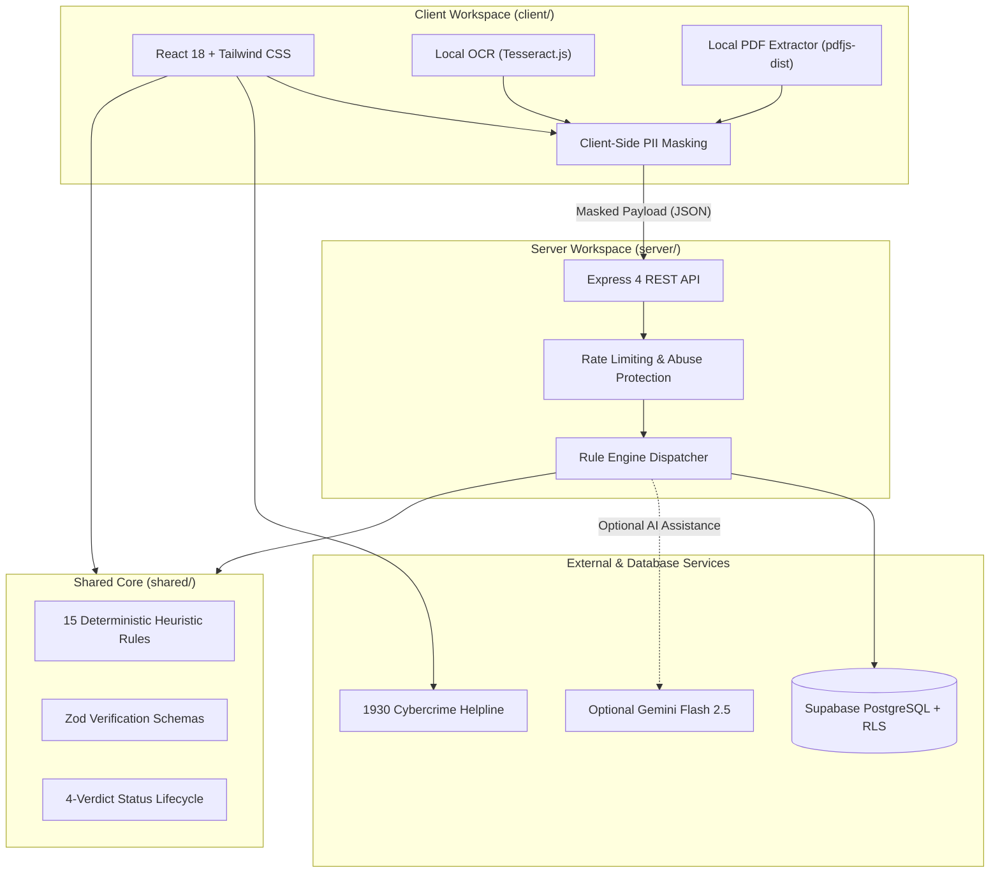

# JAANCH (जांच / ಜಾಂಚ್)

> **Digital Trust & Safety Platform for Indian Students**  
> *Know it's real before you reply.*

[](https://www.typescriptlang.org/)
[](https://nodejs.org/)
[](LICENSE)
[-brightgreen.svg)]()
[-brightgreen.svg)]()
[](https://www.w3.org/WAI/standards-guidelines/wcag/)

---

## 1. Problem Statement

Every year, thousands of college students and fresh graduates in India lose their savings to predatory employment fraud. Fraudulent recruiters exploit hope and urgency by demanding upfront "laptop security deposits," "training certification fees," "document verification charges," or bank OTPs over WhatsApp and Telegram.

**Jaanch** was built as an open, free, and privacy-preserving public service. It empowers students with deterministic heuristics, client-side privacy redaction, and community threat intelligence to verify internship, scholarship, and job offers before transferring money or compromising personal documents.

---

## 2. Live Deployments

* 🌐 **Production Web Application:** [https://jaanch-mu.vercel.app](https://jaanch-mu.vercel.app)
* 🚀 **Production API Health Check:** [https://jaanch-server.onrender.com/api/health](https://jaanch-server.onrender.com/api/health)

> [!NOTE]
> **Render Free-Tier Cold Starts:** The backend API server is hosted on Render's free tier. If the service has been idle, the initial healthcheck or analysis request may take approximately 20–30 seconds to wake up the container. Subsequent requests respond with sub-100ms latency.

---

## 3. Why Jaanch?

* **Deterministic Rules & Audit Trail:** 15 strict heuristic rule families rooted in Indian law and employment norms. Every verdict displays transparent "Why this Status" evidence cards rather than opaque AI black-box answers.
* **Shared Scam Intelligence Across Users:** Cryptographic HMAC-SHA256 hashed indicators allow students to benefit from previously discovered threats without exposing the reporter's personal identity.
* **Zero Mandatory Cloud Dependencies:** The core rule engine runs completely offline without requiring any third-party API keys or generative AI tokens.
* **Native Trilingual Support:** Built from the ground up for English, Hindi (हिंदी), and Kannada (ಕನ್ನಡ), including negation-aware keyword matching and Tesseract.js client-side OCR.

---

## 4. Product Walkthrough

<!-- Drop an updated screenshot or walkthrough GIF of the Results page into docs/ui-shots/results-walkthrough.png -->
```
+-------------------------------------------------------------------------+
| [JAANCH-AUDIT]  Know it's real before you reply.                        |
|                                                                         |
|  [HIGH_CONCERN]  CRITICAL THREAT DETECTED                               |
|  Confidence: 94% | Rules Triggered: 2                                    |
|                                                                         |
|  Evidence Bullets:                                                      |
|   - Upfront Deposit: Demanded ₹3,500 refundable laptop security fee     |
|   - Impersonation: Unofficial domain (@tcs-careers.org vs tcs.com)       |
|                                                                         |
|  Actions: [Download PDF Report] [Share Alert on WhatsApp] [Call 1930]   |
+-------------------------------------------------------------------------+
```

---

## 5. Feature Inventory

Based on verified project features:

* **In-Browser Text & Document Extractor:** Support for pasted text, text-layer PDFs via `pdfjs-dist`, and scanned image OCR via `tesseract.js` (processed 100% locally in browser memory).
* **Client-Side PII Masking:** Automatically redacts Indian phone numbers, emails, UPI IDs, bank account numbers, and Aadhaar numbers before network dispatch.
* **4-Verdict Evaluation Model:**
  * `LIKELY_GENUINE`: Verified against corroborating signals; no disqualifiers detected.
  * `NEEDS_REVIEW`: Incomplete details, missing verification, or unverified contact information.
  * `HIGH_CONCERN`: Hard disqualifiers present (upfront deposits, OTP sharing, coercive urgency).
  * `CONFIRMED_SCAM`: Matched a community threat intelligence record explicitly confirmed by a human moderator.
* **Official Indian Verification Portals:** One-click corroboration against the Ministry of Corporate Affairs (MCA), National Career Service (NCS), National Scholarship Portal (NSP), and AICTE Internship Portal.
* **Emergency Response Integration:** Direct click-to-call integration with India's National Cyber Crime Helpline **1930** and direct links to [cybercrime.gov.in](https://cybercrime.gov.in).
* **WhatsApp Scam Alert Generator:** Generates formatted `wa.me` warning messages for peer student groups without automated background sending.
* **Recruiter Challenge & Safe Reply Email Generator:** Deterministic and optional AI templates to challenge suspicious recruiters or request official domain confirmation.
* **Moderator Intelligence Lifecycle:** Distinct indicator progression (`reported` ──▶ `unverified` ──▶ `ai_flagged` ──▶ `suspicious` ──▶ `confirmed`) protected by human-in-the-loop controls and an institutional allowlist.

---

## 6. System Architecture



---

## 7. Technology Stack

| Layer | Technologies |
| :--- | :--- |
| **Frontend** | React 18, Vite 6, Tailwind CSS, Lucide React, Framer Motion, `@react-pdf/renderer` |
| **Backend** | Node.js (v20+), Express 4, Zod, Helmet, Pino, CORS |
| **Data & Auth** | Supabase PostgreSQL, Row-Level Security (RLS), HMAC-SHA256 Peppering |
| **Local Inference** | `tesseract.js` (Client OCR), `pdfjs-dist` (Client PDF parsing) |
| **Languages & Tooling** | TypeScript 5 (Strict), Vitest, Playwright/Puppeteer, Semgrep, FFmpeg |

---

## 8. Quickstart

### Prerequisites
* **Node.js**: `v20.0.0` or higher (`v24.x` recommended)
* **npm**: `v10.0.0` or higher

### 1. Clone Repository & Install Dependencies
```bash
git clone https://github.com/sharathbk910/Jaanch.git
cd Jaanch
npm install
```

### 2. Configure Environment Variables
Copy the example environment files for server and client:
```bash
cp server/.env.example server/.env
cp client/.env.example client/.env
```

### 3. Start Development Servers
Start both the API backend and Vite client concurrently:
```bash
npm run dev
```

* **Frontend:** [http://localhost:5173](http://localhost:5173)
* **Backend:** [http://localhost:8080](http://localhost:8080)
* **Healthcheck:** [http://localhost:8080/api/health](http://localhost:8080/api/health)

---

## 9. Environment Variables

All variables are validated on startup via Zod schemas:

| Variable | Workspace | Required | Description |
| :--- | :--- | :--- | :--- |
| `PORT` | `server` | No (default: 8080) | Port for Express server |
| `NODE_ENV` | `server` | No (default: development) | Node environment mode |
| `CLIENT_ORIGINS` | `server` | Yes | Comma-separated allowed CORS origins |
| `SUPABASE_URL` | `server`, `client` | Yes (for auth/data) | Supabase project API URL |
| `SUPABASE_ANON_KEY` | `server`, `client` | Yes (for auth/data) | Supabase client anon key |
| `SUPABASE_SERVICE_ROLE_KEY` | `server` | Production only | Supabase administrative key |
| `SUPABASE_JWT_SECRET` | `server` | Production only | Supabase JWT secret (>= 32 chars) |
| `REPORT_HASH_PEPPER` | `server` | Yes (>= 24 chars) | Salt pepper for HMAC-SHA256 hashing |
| `GEMINI_API_KEY` | `server` | Optional | Google Gemini API key for AI explanations |
| `GEMINI_MODEL` | `server` | No (default: gemini-2.5-flash) | Target model for AI assistant |
| `ML_API_URL` | `server` | No (default: http://localhost:8000) | Python ML microservice URL |
| `ML_TIMEOUT_MS` | `server` | No (default: 3000) | ML request timeout threshold |
| `VITE_API_BASE_URL` | `client` | No (default: /api proxy) | Backend API endpoint URL |

---

## 10. Verification & Test Commands

Every commit is gated by a full test and compliance harness:

```bash
# Run all unit and integration tests (455 tests across 46 files)
npm test

# Run deterministic benchmark evaluation (25/25 corpus verification)
npm run eval

# Run ML calibration and similarity threshold evaluation
npm run eval:ml

# Execute codebase linting, banned phrases, and color checks
npm run lint

# Monorepo TypeScript typecheck across all workspaces
npm run typecheck

# Acceptance criteria compliance harness
npm run test:acceptance

# Static application production build
npm run build

# Security scan via Semgrep
npm run security:scan

# Environment and service health doctor
npm run doctor
```

---

## 11. Deployment

* Full deployment runbooks and configuration checklists are documented in [docs/DEPLOY.md](docs/DEPLOY.md).
* **Frontend:** Hosted on Vercel with automatic rewrites to the API backend.
* **Backend:** Hosted on Render with HTTPS and healthcheck monitors.

---

## 12. Known Limitations

* **Benchmark Corpus Provenance:** The 25 evaluation test fixtures represent curated, synthetic scam models covering typical Indian student fraud patterns. It does not replace live threat intelligence.
* **Moderator-Dependent Confirmation:** The `CONFIRMED_SCAM` verdict is never generated by automated keyword or AI heuristics alone; it strictly requires corroboration by a human moderator or cross-matched community record.
* **In-Browser OCR Performance:** Tesseract.js execution speed depends entirely on the end user's device capabilities and CPU architecture.

---

## 13. Disclaimer & License

> **Public Service Notice:** Jaanch evaluates automated heuristic signals and community threat indicators. Analysis does **not** prove that an opportunity is genuine or fraudulent. Students must always corroborate offers through official institutional channels before transferring money or sharing identity documents.

This project is licensed under the [MIT License](LICENSE).
