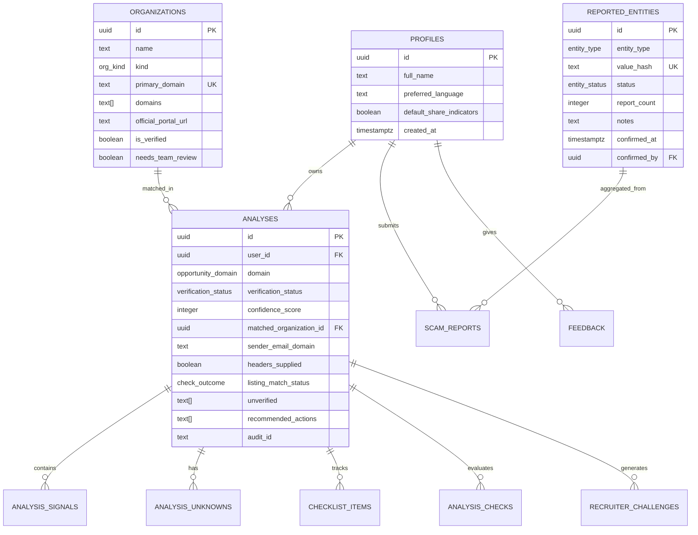

# JAANCH – Database Schema Documentation

**Database Engine:** PostgreSQL (Supabase)  
**Schema Migration Version:** Consolidated 0001–0003  
**Specification Authority:** `docs/SPEC_ORIGINAL.md` (Decision D14) & `docs/SPEC_ADDENDUM.md`  

---

## 1. Entity-Relationship Overview

---

## 2. Enumerated Types

| Enum Name | Allowed Values | Purpose |
|---|---|---|
| `opportunity_domain` | `'job'`, `'internship'`, `'scholarship'`, `'freelance'`, `'competition'`, `'other'`, `'general_message'` | Classification of offer domain |
| `input_type` | `'raw_text'`, `'screenshot'`, `'pdf_document'` | Source medium of student input |
| `risk_level` | `'HIGH_RISK'`, `'NEEDS_VERIFICATION'`, `'NO_MAJOR_WARNING_SIGNS'` | 3-level evaluation for hyperlinks only |
| `verification_status` | `'LIKELY_GENUINE'`, `'NEEDS_REVIEW'`, `'HIGH_CONCERN'`, `'CONFIRMED_SCAM'` | 4-verdict offer assessment model |
| `signal_severity` | `'critical'`, `'high'`, `'medium'`, `'low'`, `'info'` | Signal impact level |
| `signal_source` | `'rule'`, `'ai_observed'` | Provenance of identified signal |
| `signal_category` | `'payment'`, `'urgency'`, `'data_request'`, `'missing_details'`, `'channel'`, `'too_good_to_be_true'`, `'link'`, `'sender_identity'`, `'source_authenticity'`, `'reported_record'`, `'content_quality'` | Grouping of scam heuristics |
| `check_outcome` | `'pass'`, `'fail'`, `'unknown'`, `'not_run'`, `'user_attested'`, `'none_found'` | State of each independent check |
| `entity_type` | `'email'`, `'domain'`, `'phone'`, `'upi'`, `'bank_account'` | Type of extracted threat indicator |
| `entity_status` | `'reported'`, `'unverified'`, `'ai_flagged'`, `'suspicious'`, `'confirmed'`, `'dismissed'`, `'disputed'` | Threat intelligence lifecycle |
| `org_kind` | `'corporation'`, `'government'`, `'educational'`, `'ngo'`, `'other'` | Entity sector |
| `channel_type` | `'whatsapp'`, `'telegram'`, `'email'`, `'sms'`, `'job_portal'`, `'other'` | Channel of scam approach |

---

## 3. Table Definitions & Constraints

### 3.1 `profiles`
Mirrors Supabase `auth.users` via trigger `on_auth_user_created`.
- `id` (UUID, PK): References `auth.users(id)` ON DELETE CASCADE.
- `full_name` (TEXT): Display name.
- `preferred_language` (TEXT): `'en'`, `'hi'`, or `'kn'` (default `'en'`).
- `default_share_indicators` (BOOLEAN): Consent default (default `false`).
- `created_at`, `updated_at` (TIMESTAMPTZ).

### 3.2 `organizations`
Verified corporate and government directory.
- `id` (UUID, PK): `gen_random_uuid()`.
- `name` (TEXT, NOT NULL): Official company/organization name.
- `kind` (`org_kind`, NOT NULL): Sector classification.
- `primary_domain` (TEXT, NOT NULL, UNIQUE): Canonical web domain.
- `domains` (TEXT[], NOT NULL): Subdomains and aliases.
- `official_portal_url` (TEXT): Official career portal URL.
- `is_verified` (BOOLEAN, NOT NULL): True for verified entries.
- `needs_team_review` (BOOLEAN, NOT NULL, DEFAULT true): Review flag (Decision D10).

### 3.3 `analyses`
Saved verification analyses for authenticated students (Guests persist nothing server-side).
- `id` (UUID, PK): Analysis record identifier.
- `user_id` (UUID, NOT NULL): FK references `auth.users(id)` ON DELETE CASCADE.
- `domain` (`opportunity_domain`, NOT NULL): Classified offer type.
- `verification_status` (`verification_status`, NOT NULL): Verdict.
- `confidence_score` (INT, NOT NULL): Between 0 and 100.
- `matched_organization_id` (UUID, FK): References `organizations(id)` ON DELETE SET NULL.
- `sender_email_domain` (TEXT): Extracted or provided domain.
- `headers_supplied` (BOOLEAN): True if email headers were parsed.
- `listing_match_status` (`check_outcome`): Official portal match status.
- `unverified` (TEXT[]): List of unverified checks.
- `recommended_actions` (TEXT[]): Tailored action checklist.
- `audit_id` (TEXT, NOT NULL): Audit tracking ID.

### 3.4 `analysis_signals`
Granular signals generated by the rule engine and optional AI observer.
- `id` (UUID, PK).
- `analysis_id` (UUID, NOT NULL, FK): Cascades on delete.
- `rule_id` (TEXT, NOT NULL): Catalog rule identifier (e.g. `RULE_UPFRONT_FEE`).
- `category` (`signal_category`, NOT NULL).
- `title`, `why_it_matters`, `evidence` (TEXT, NOT NULL).
- `severity` (`signal_severity`, NOT NULL).
- `source` (`signal_source`, NOT NULL, DEFAULT `'rule'`).

### 3.5 `checklist_items`
Student next-steps action items.
- `id` (UUID, PK).
- `analysis_id` (UUID, NOT NULL, FK).
- `step_key` (TEXT, NOT NULL).
- `completed` (BOOLEAN, NOT NULL, DEFAULT false).
- `completed_at` (TIMESTAMPTZ).
- Constraint: `UNIQUE(analysis_id, step_key)` prevents duplicate step tracking.

### 3.6 `reported_entities`
Community threat database of hashed indicators.
- `id` (UUID, PK).
- `entity_type` (`entity_type`, NOT NULL).
- `value_hash` (TEXT, NOT NULL, UNIQUE): Salted SHA-256 hash using `REPORT_HASH_PEPPER`.
- `status` (`entity_status`, NOT NULL, DEFAULT `'unverified'`).
- `report_count` (INT, NOT NULL, DEFAULT 1).
- `notes` (TEXT): Moderator investigation notes.
- `confirmed_at` (TIMESTAMPTZ), `confirmed_by` (UUID FK).

### 3.7 `scam_reports`
Raw user incident submissions.
- `id` (UUID, PK).
- `user_id` (UUID, FK).
- `entity_type`, `value_hash`, `channel`, `description`.

### 3.8 `feedback` & `page_feedback`
User product feedback and page ratings.
