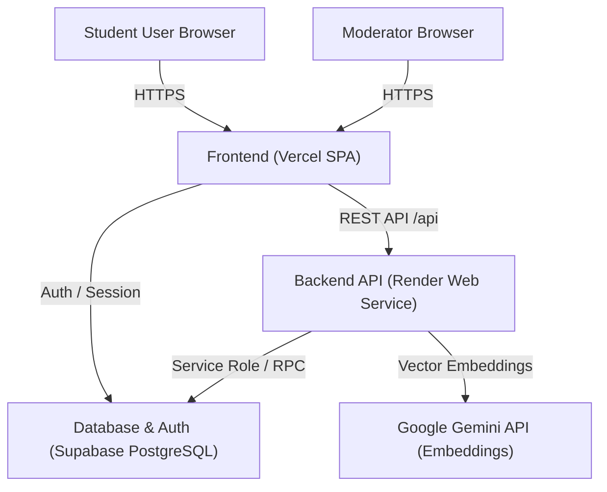

# JAANCH – Production Deployment Guide

> [!CAUTION]
> **DEPLOYMENT POLICY INVARIANT**
> **Do NOT deploy anything or use personal user accounts without explicit user approval. Prepare all configurations, verify locally, and request confirmation before performing any external deployment actions.**

---

## Architecture Overview



---

## 1. Supabase Database Deployment

### A. Project Provisioning
1. Create a new project in the [Supabase Dashboard](https://supabase.com).
2. Note your project credentials from **Project Settings → API**:
   - **Project URL**: `https://<project-ref>.supabase.co`
   - **anon / public key**: `eyJh...`
   - **service_role key**: `eyJh...` (Store securely; never expose to client!)
   - **JWT Secret**: `Project Settings → API → JWT Settings → JWT Secret`

### B. Applying Database Migrations from Scratch
Run migrations in numerical order using either the Supabase CLI or SQL Editor:

```bash
# Link local repository to your remote Supabase project
npx supabase link --project-ref <your-project-ref>

# Apply all migrations from scratch
npx supabase db push
```

Alternatively, apply sequentially in the Supabase SQL Editor:
1. `supabase/migrations/0001_enums_tables.sql`
2. `supabase/migrations/0002_rls_functions.sql`
3. `supabase/migrations/0003_seed_organizations.sql`
4. `supabase/migrations/0004_shared_intel.sql`
5. `supabase/migrations/0005_ai_ml_vector_similarity.sql`
6. `supabase/migrations/0006_rate_limiting.sql`

### C. Verify Clean Schema
Verify the migration status locally:
```bash
node scripts/verify-migrations.mjs
node scripts/test-clean-migrations.mjs
```

---

## 2. Backend API Deployment (Render)

### A. Deploy via Blueprint (`render.yaml`)
1. In the [Render Dashboard](https://dashboard.render.com), click **New + → Blueprint**.
2. Connect the `Jaanch AI` repository.
3. Render reads `render.yaml` and configures the `jaanch-server` web service.

### B. Required Production Environment Variables
Set the following environment variables in the Render Dashboard (**Services → jaanch-server → Environment**):

| Variable | Description | Example / Constraint |
| :--- | :--- | :--- |
| `NODE_ENV` | Environment mode | `production` |
| `PORT` | Listening port | `10000` |
| `CLIENT_ORIGINS` | Permitted frontend origins | `https://jaanch.vercel.app` (Exact URL, no trailing slash) |
| `SUPABASE_URL` | Supabase API URL | `https://<project-ref>.supabase.co` |
| `SUPABASE_ANON_KEY` | Public anon key | `eyJhbGciOi...` |
| `SUPABASE_SERVICE_ROLE_KEY` | Server-only service role | `eyJhbGciOi...` |
| `SUPABASE_JWT_SECRET` | Supabase JWT Secret ($\ge 32$ chars) | Real secret from Supabase Dashboard |
| `REPORT_HASH_PEPPER` | Cryptographic salt pepper ($\ge 24$ chars) | Random 64-char hex or passphrase (NOT default) |
| `GEMINI_API_KEY` | Google Gemini API key | Optional for semantic embeddings |
| `GEMINI_MODEL` | Gemini model ID | `gemini-2.5-flash` |
| `LOG_LEVEL` | Pino logging level | `info` |

> [!IMPORTANT]
> The server will strictly **refuse to boot** if `REPORT_HASH_PEPPER` is missing, shorter than 24 characters, or set to the default placeholder.

---

## 3. Frontend Deployment (Vercel)

### A. Project Import
1. In the [Vercel Dashboard](https://vercel.com/dashboard), click **Add New... → Project**.
2. Import the `Jaanch AI` repository.
3. Vercel automatically detects Vite settings from `vercel.json`:
   - **Framework Preset**: Vite
   - **Root Directory**: `./`
   - **Build Command**: `npm run build -w client`
   - **Output Directory**: `client/dist`

### B. Required Frontend Environment Variables
Set these under **Settings → Environment Variables**:

| Variable | Description | Target Environments |
| :--- | :--- | :--- |
| `VITE_API_BASE_URL` | Render backend URL | Production, Preview |
| `VITE_SUPABASE_URL` | Supabase project URL | Production, Preview |
| `VITE_SUPABASE_ANON_KEY` | Supabase anon key | Production, Preview |

---

## 4. First-Moderator Bootstrapping

Once the database and backend are live:
1. Have the prospective moderator sign up via the frontend UI or Supabase Auth.
2. Promote the user's role to `moderator` using the service script:
   ```bash
   SUPABASE_URL=https://<ref>.supabase.co SUPABASE_SERVICE_ROLE_KEY=<key> \
     npx tsx scripts/bootstrap-moderator.ts moderator@campus.edu
   ```
3. The user now has access to `/moderation` and all trust & safety triage endpoints.

---

## 5. Post-Deployment Smoke Verification

Run the remote smoke test against the live production deployment:

```bash
SMOKE_TARGET_URL=https://jaanch-api.onrender.com node scripts/smoke.mjs
```

The script verifies:
- `GET /api/health` and `/api/health/ready` (database liveness and readiness)
- `GET /api/config` (safe public config without secrets)
- `POST /api/analyze` (Genuine offer classification)
- `POST /api/analyze` (Upfront fee scam detection)
- `POST /api/analyze` (OTP phishing detection)
- `POST /api/link-check` (Domain intelligence lookup)
- Response compression (`gzip`/`br`)
- Security headers (Helmet CSP, HSTS, frame options, XSS protection)

---

## 6. Rollback Procedures

If an incident occurs in production:

### A. Frontend Rollback (Vercel)
1. Go to **Deployments** in the Vercel Dashboard.
2. Select the previous stable deployment (or commit tagged `phase-10-done`).
3. Click **Instant Rollback**.

### B. Backend Rollback (Render)
1. In Render Dashboard, under **Deploys**, select the previous green build.
2. Click **Rollback to this deploy**.
3. Or locally:
   ```bash
   git reset --hard phase-10-done
   git push origin main --force-with-lease
   ```

### C. Database Rollback
If a database migration must be rolled back, execute the corresponding `.down.sql` scripts in reverse numerical order:
```bash
# Example: Rolling back rate limiting and AI ML extensions
psql $DATABASE_URL -f supabase/migrations/0006_rate_limiting.down.sql
psql $DATABASE_URL -f supabase/migrations/0005_ai_ml_vector_similarity.down.sql
```

