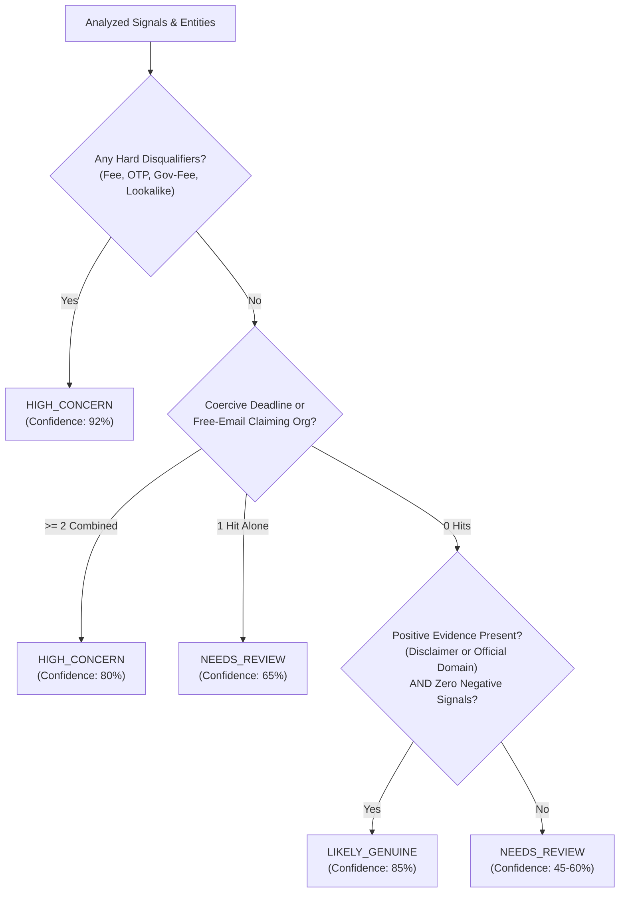

# JAANCH – Deterministic Rule Catalog & Status Computation Policy

> [!NOTE]
> This document specifies the deterministic detection rules, negation boundaries, signal classification, and status computation matrix implemented in `@jaanch/shared`.

---

## 1. Overview & Core Philosophy

Jaanch operates on deterministic evidence. It enforces strict separation between automated heuristics and authoritative certainty:
1. **Never Assert Certainty:** Probabilistic certainty claims (e.g. "100% safe", "definitely a scam") are prohibited across all rule descriptions and outputs.
2. **Evidence-Gated Statuses:**
   - `CONFIRMED_SCAM` can **never** be generated by this library from text alone; it requires a confirmed intelligence record verified by a human moderator.
   - `LIKELY_GENUINE` requires corroborating positive evidence (an official non-fee recruitment disclaimer or a verified enterprise corporate sender domain) and zero negative indicators.
3. **Absence of Negative Evidence ≠ Legitimacy:** When an opportunity text is free of red flags but lacks independently verifiable corporate listing proof, it resolves strictly to `NEEDS_REVIEW`.
4. **Clause-Scoped Negation:** Detection rules enforce clause boundaries (`[.!?;\n]`) to prevent genuine disclaimers ("we do not charge any fee") from triggering false fee alerts.

---

## 2. Rule Catalog

| Rule ID | Title | Hard Disqualifier | Severity | Covered Concepts & Languages |
|---|---|---|---|---|
| **`RULE_UPFRONT_FEE`** | Upfront Payment or Deposit Demanded | **Yes** | Critical | Registration fees, training fees, security deposits, kit costs, laptop courier fees. Patterns in EN, HI, Hinglish, KN. Negation guarded. |
| **`RULE_BANK_OTP_DEBIT`** | Sensitive Financial Credentials / OTP Requested | **Yes** | Critical | Requests for OTP, PIN, debit/credit card CVV, NetBanking passwords, cheque overpayment. Negation guarded ("never share OTP"). |
| **`RULE_COERCIVE_DEADLINE`** | Artificial Urgency & Coercive Deadline | No | Medium | Coercive pressure tactics ("within 2 hours", "offer expires today", "turant paise bheje", "tavartavagi"). Single: `NEEDS_REVIEW`; 2+ combined: `HIGH_CONCERN`. |
| **`RULE_FREE_EMAIL_CLAIMING_ORG`** | Free Personal Email for Corporate Offer | No | Medium | Identifies when communication claims an established corporate entity while sending from free webmail (`@gmail.com`, `@yahoo.com`, `@outlook.com`, etc.). Single: `NEEDS_REVIEW`; 2+ combined: `HIGH_CONCERN`. |
| **`RULE_LOOKALIKE_DOMAIN`** | Lookalike or Typosquatting Brand Domain | **Yes** | Critical | Typosquatting (Levenshtein ≤ 2), homoglyph/digit substitutions (`0` for `o`, `1` for `l`), Punycode (`xn--`), and brand keyword additions (`tcs-jobs-india.net`). |
| **`RULE_OFFICIAL_GOV_FEES`** | Government Scheme Fee / Non-Gov Link | **Yes** | Critical | Claims to represent an Indian government scheme (PMKVY, NATS, AICTE, Sarkari Yojana) but demands fees or links to non-`.gov.in` / non-`.nic.in` sites. |
| **`RULE_UNVERIFIED_LISTING`** | Opportunity Not Corroborated by Official Listing | No | Low | Incomplete verification; flags when an organization is mentioned without matching verified official portal evidence. |
| **`RULE_GENUINE_DISCLAIMER`** | Official Non-Fee Recruitment Policy Disclaimer | No (Positive) | Info | Positive evidence signal: verified corporate disclaimer stating the organization never charges recruitment fees. |

---

## 3. Status Computation Decision Matrix

### Precedence Table

| Condition | Resulting Status | Confidence Score |
|---|---|---|
| Any Hard Disqualifier triggered (`RULE_UPFRONT_FEE`, `RULE_BANK_OTP_DEBIT`, `RULE_OFFICIAL_GOV_FEES`, `RULE_LOOKALIKE_DOMAIN`) | **`HIGH_CONCERN`** | `92` |
| Two or more combined subtle signals (`RULE_COERCIVE_DEADLINE` + `RULE_FREE_EMAIL_CLAIMING_ORG`) | **`HIGH_CONCERN`** | `80` |
| Single subtle signal alone (`RULE_COERCIVE_DEADLINE` or `RULE_FREE_EMAIL_CLAIMING_ORG`) | **`NEEDS_REVIEW`** | `65` |
| `RULE_UNVERIFIED_LISTING` or incomplete details without positive evidence | **`NEEDS_REVIEW`** | `45–60` |
| Zero negative signals **AND** positive evidence (`RULE_GENUINE_DISCLAIMER` or verified official sender domain) | **`LIKELY_GENUINE`** | `85` |
| Moderator-verified intelligence match (Phase 7 only; outside shared core) | **`CONFIRMED_SCAM`** | `98` |

---

## 4. Unverified Items (`unverified[]`)

Every analysis response deterministically populates `unverified[]` to clarify what remains unconfirmed:
- **Sender Domain Verification:** Flagged when sender does not originate from a registered enterprise domain.
- **Careers Page Matching:** Flagged when the opportunity text has not been cross-referenced against an official company listing.
- **Direct Phone Verification:** Flagged when contact phone numbers are unlisted in published directories.
- **Certificate Transparency / Domain Age:** Informs that external RDAP and CT logs have not been queried.

---

## 5. Security & Boundary Guarantees

1. **ReDoS Immunity:** All regular expressions are strictly bounded and non-backtracking. Tested against 100,000-character adversarial inputs with completion in < 5ms.
2. **Input Length Cap:** Input is safely capped at 50,000 characters before normalization to prevent memory exhaustion.
3. **No Code Execution:** Evaluates purely via static TypeScript logic without `eval` or dynamic code invocation.
4. **Privacy-Preserving PII Redaction:**
   - Raw text extracted first for rule evaluation.
   - PII (Aadhaar, phone, UPI, email user) masked with tokens.
   - Email domain is retained (e.g. `[EMAIL]@gmail.com`) to allow domain safety verification without leaking student mailbox names.
   - Indicators returned only when user explicitly opts into `shareIndicators`.
